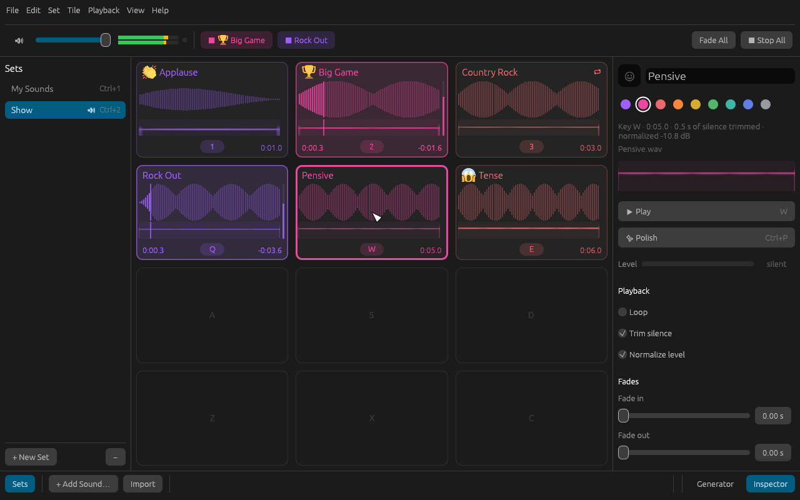
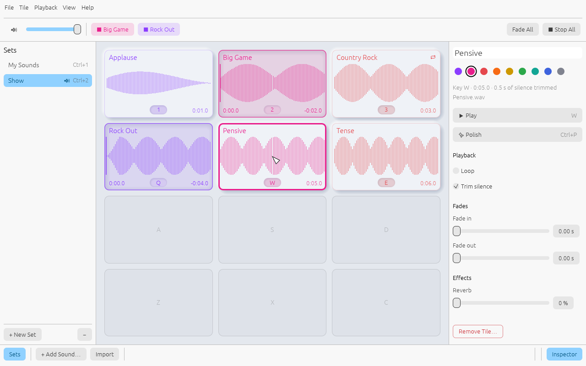
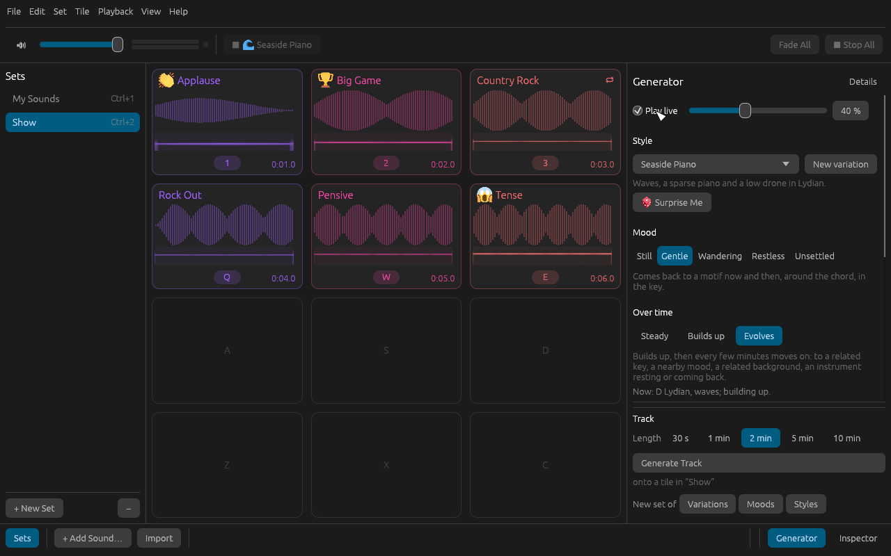

# Olio

A keyboard-driven soundboard for macOS and Windows, in the spirit of Rogue
Amoeba's [Farrago](https://rogueamoeba.com/farrago/): sets of tiles laid out
on your keyboard, one key per sound, for live shows, podcasts, streams and
theatre. Rust audio engine, [egui](https://github.com/emilk/egui) desktop
app.



The window follows the system theme; there is a [light version](docs/images/window-light.png)
too, or pick one in the View menu. View ▸ Soft Tiles draws tiles as
raised buttons that press in while they play:



The Generator makes gentle music and backgrounds, live or as tracks on
tiles:



> *Olio* is a medley, the same meaning as *farrago*.

## Status

Milestone 0, the playable skeleton, is done. Olio can:

- **Play sounds from the keyboard.** Each set is a grid that follows the
  keyboard: `1`–`0`, `Q`–`P`, `A`–`;`, `Z`–`/`, and the same keys with
  Option (Alt) for four more rows. Press a key or double-click a tile to
  play it, press again to stop. Hold Esc to stop everything, `-` to fade
  everything out. The arrow keys move the selection and Return plays it.
- **See what is loud.** A stereo level meter beside the master volume,
  with a lamp that lights when the output clips; a meter on every playing
  tile; and the selected tile's level in the inspector.
- **Mark tiles with emoji.** Click the well beside a tile's title (or
  ⌘E / Ctrl+E) to pick one from a searchable picker; boards can set them
  too. Emoji are drawn in colour from Twemoji, the same on both
  platforms.
- **Polish in one click.** ✨ Polish in the inspector (⌘P / Ctrl+P, or
  right-click a tile) gives a tile a 1 s fade in, a 1 s fade out and
  30 % reverb; click again to take it off. Tile ▸ Polish All Tiles in Set
  does a whole set, handy after importing a folder. Change what Polish
  gives in Playback ▸ Polish Preset.
- **Stay in control.** A master volume and mute in the toolbar, a bubble
  for every playing sound, Fade All and Stop All. Removing a tile happens
  at once and ⌘Z (Ctrl+Z) or the Undo button in the status bar puts it
  back; removing a set asks first and can be undone too.
- **Arrange the board.** Drag a tile to another slot to give it that key;
  drop it on another tile and the two swap, with a preview of where each
  will go. Drop it on a set in the sidebar to move it to that set,
  keeping its key if that slot is free there, or hold it over the set for
  a moment to open it and drop the tile on the slot you want; let go
  anywhere else, or press Esc, and you are back where you started. Hold Option (Ctrl on
  Windows) while dropping to drop a copy instead, or press ⌘D (Ctrl+D) to
  duplicate the selected tile. Shift and an arrow key move the selected
  tile from the keyboard. ⌘Z undoes any of it.
- **Fit more on screen.** Each set is 1 to 10 columns wide: ⌘] and ⌘[
  (Ctrl on Windows), Set ▸ Columns, or the stepper in the inspector when
  no tile is selected. Fit to Window (⌘\\) picks as many columns as fit
  the window at the current tile size without scrolling sideways. A set
  never gets narrower than its right-most tile, so no sound loses its
  key. View ▸ Compact Tiles shows just the title, key and time, so a
  full board of 80 fits on a laptop screen at full size or with the side
  panels hidden (⇧⌘S, ⇧⌘I); Large Tiles suit touch screens and reading
  from across a room. ⇧⌘T (Ctrl+Shift+T) steps through Compact, Regular
  and Large.
- **Generate gentle music.** The Generator (⇧⌘G, or the Generator
  button in the status bar) makes up sparse, quiet music as it goes, in
  place of the inspector. It shows the essentials (a style, a mood, how
  it changes over time, a background, which instruments play);
  **Details** adds every setting
  for fine adjustment:
  - **a background**: rain, distant thunder, wind, a winter wind, waves
    on a shore, a forest with a bird now and then, a desert wind, or a
    crackling fire, with a level of its own against the instruments;
  - **up to nine instruments**: a plucked bass, a harp, bells, bowed
    strings, a pad, a drone, a piano, a plucked violin and soft hand
    drums (a frame drum and a shaker), with a level for them all
    together against the background, and each its own level, a Notes
    slider from very sparse to busy, and register;
  - **a key** from the seven Greek (church) modes, pentatonics, harmonic
    minor or whole tone;
  - **character**: *Variety* (a short motif that keeps coming back, up to
    ever-new melodies and chords), *Concentration* (notes wandering wide,
    down to gathered close around the chord and the home note) and
    *Chaos* (from in the key to notes outside it, clashing seconds,
    tritones and clusters);
  - **over time**: *Steady*; *Builds up*, one instrument first and the
    others joining one at a time as the mood opens; or *Evolves*, which
    builds up and then every few minutes moves on to a related key, a
    nearby mood, a related background, or lets an instrument rest; the
    panel says where it has got to while it plays;
  - **presence**, from *Background* (barely there) to *Declarative*
    (louder, on a slow pulse, with cadences), and **form**: endless, or
    pieces that close on the root and pause.

  Styles such as Rain Study, Seaside Piano, Forest Morning, Campfire,
  Desert Night and Storm Watch fill it all in; touch anything and it is
  yours, and Save Style… keeps it in the Style list under a name of your
  own (rename or remove it there; ⌘Z brings a removed one back).
  🎲 Surprise Me (⇧⌘R) plays something new at once, picked from what
  sounds well together; Back returns to what you had. Play it live behind your sounds as the ambience (⇧⌘B, or
  Playback ▸ Ambience): it ducks while sounds play and never gets near
  their level. Or press Generate Track to render 30 s to 10 min of it
  into the library onto a tile, titled after its style and length, to
  play, loop and polish like any sound; ⌘Z takes it off again. *New set
  of* renders several at once into a set of their own: four
  *Variations* of the settings, the style in each of the five *Moods*,
  or every *Style*, yours included; one ⌘Z takes the whole set off.
- **Find your way.** Menus list every command with its shortcut (Help ▸
  Keyboard Shortcuts has them all), written the way the platform writes
  them.
- **Shape each sound.** The inspector sets a tile's name, colour, loop, fade
  in, fade out (also used when you stop it) and reverb. Silence at the
  start and end of a sound is trimmed automatically, and every sound is
  normalized: played at the same loudness (-18 dBFS RMS), never louder
  than -1 dBFS at its peak, so a quiet recording and a loud one sit
  together. None of this changes the audio file.
- **See each sound.** Every tile shows its waveform and, under it, a small
  spectrogram in the tile's colour: low frequencies at the bottom, high at
  the top, so a kick, a siren and applause look as different as they
  sound. View ▸ Spectrograms turns them off.
- **Import in bulk.** Drop or pick files, whole folders (each becomes a set,
  in alphabetical order), or a board written in JSON. Video files (MP4,
  MOV, M4V, MKV) are imported as their audio track.
- **Script boards.** `olio import board.json` builds sets from a JSON file
  without opening a window; see [docs/BOARD-JSON.md](docs/BOARD-JSON.md).
  `olio generate --style "Rain Study" --seconds 120` renders Generator
  styles to WAV files the same way; `--variety`, `--concentration` and
  `--chaos` (0 to 100) set their character.
- **Read most formats.** WAV, AIFF, CAF, FLAC, MP3, AAC and ALAC (M4A), Ogg
  Vorbis, and the audio of MP4/MOV video.

Next up ([docs/ROADMAP.md](docs/ROADMAP.md)): solo, pausable and
hold-to-play tiles, volume A/B, Pause/Fade All, list mode, a waveform
editor, MIDI, OSC and **Stream Deck** support.

## Build and run

The only prerequisite is a Rust toolchain from [rustup](https://rustup.rs);
`rust-toolchain.toml` pins the stable channel on every machine. The first
build compiles the GPU and UI stack and takes a few minutes.

```bash
cargo xtask run
```

To try it with sounds straight away, generate the demo pack (twelve
synthesised sounds and a board) into a scratch library and open it:

```bash
cargo xtask demo
```

```bash
cargo xtask run --library target/demo/library --set "Demo Board"
```

`cargo xtask run` builds the app and runs a copy of the binary, so it can be
rebuilt while a window is open (Windows locks a running executable).

To hear the Generator's styles without opening the app, render 30 s of
each to `target/previews/`:

```bash
cargo xtask previews
```

## Your library

Olio keeps everything in one folder: `~/Library/Application Support/Olio`
on macOS, `%APPDATA%\Olio` on Windows. Override it with `--library DIR` or
the `OLIO_LIBRARY` environment variable.

- `library.json` holds your sets and tiles; the previous version is kept as
  `library.json.bak`.
- `sounds/` holds a copy of every imported sound, named by a hash of its
  contents, so moving or deleting the originals breaks nothing and a sound
  used twice is stored once.
- `preferences.ron` remembers the window's size and position, the panel
  widths, the theme and tile style, the master volume, the Polish preset,
  the Generator's settings, your saved styles and which panels are shown.

## Development

```bash
cargo xtask check
```

Formatting, clippy with warnings denied, every test (the mixer, decoding of
each format, the library, the importer, and the window itself driven
headlessly through its accessibility tree), and a headless import of the
demo board through the real binary. CI runs the same command on macOS and
Windows. Enable the pre-commit hook once per clone with
`git config core.hooksPath .githooks`.

`OLIO_RENDER=1 cargo test -p olio-app --test window` renders the window
offscreen in both themes and both tile styles to `target/screenshots/`
(`window.png`, `window-light.png`, `window-soft.png`,
`window-soft-light.png`, and the Generator in `window-generator.png` and
`window-generator-details.png`).

Read [CLAUDE.md](CLAUDE.md) for the map of the code and
[docs/ARCHITECTURE.md](docs/ARCHITECTURE.md) for how it fits together.

## License

MIT or Apache-2.0, at your option.

Emoji graphics are from [Twemoji](https://github.com/jdecked/twemoji),
Copyright 2020 Twitter, Inc and other contributors, licensed under
[CC-BY 4.0](https://creativecommons.org/licenses/by/4.0/), through the
[twemoji-assets](https://crates.io/crates/twemoji-assets) crate. Emoji
names and search data come from the
[emojis](https://crates.io/crates/emojis) crate (Unicode CLDR and GitHub
gemoji).

The Generator's recorded instruments come from the
[Versilian Community Sample Library](https://github.com/sgossner/VCSL)
and [VSCO 2 Community Edition](https://github.com/sgossner/VSCO-2-CE) by
Sam Gossner and Versilian Studios, released into the public domain
(CC0 1.0); Olio's instrument pack trims, loops, levels and re-encodes
them and is CC0 as well (`crates/packer`, `cargo xtask instruments`).
